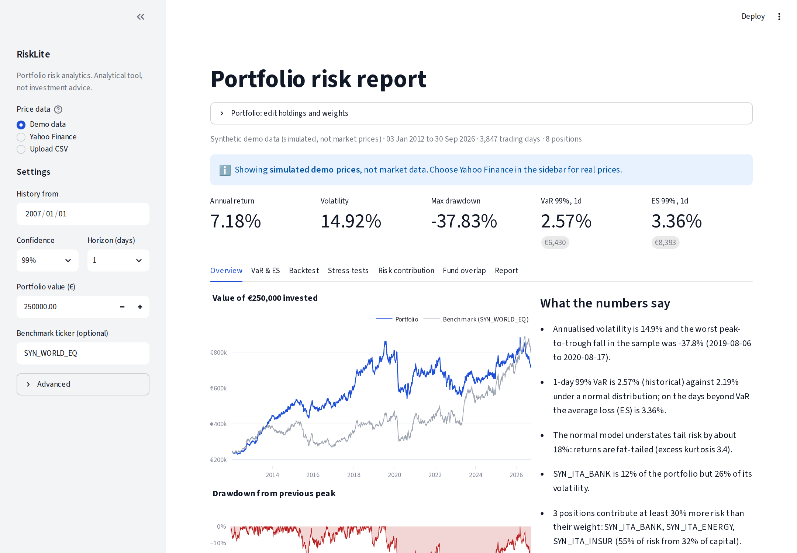

# RiskLite

**Portfolio risk analytics for independent advisors and individual investors.**

RiskLite takes a portfolio of stocks and ETFs and answers, with tested and documented maths:

* **How much could it lose?** VaR and Expected Shortfall in four ways: historical,
  parametric, Cornish-Fisher and Monte Carlo.
* **Can that number be trusted?** Rolling VaR backtests with Kupiec, Christoffersen and
  Basel traffic-light tests.
* **What if 2008, 2020 or 2022 happened again?** Historical replay plus editable
  hypothetical shocks.
* **Where does the risk really come from?** Euler risk contributions, component VaR, ES
  contributions and correlations.
* **What do I actually own?** ETF look-through and fund-to-fund overlap.

🔗 **Live app:** `https://<your-app>.streamlit.app` *(add after deploying, see below)*



> RiskLite is an analytical tool that describes historical risk. It does not give investment
> advice.

---

## Quick start

```bash
git clone https://github.com/<you>/risklite.git
cd risklite
python -m venv .venv && source .venv/bin/activate   # Windows: .venv\Scripts\activate
pip install -r requirements-dev.txt
streamlit run app.py
```

The app opens on simulated **demo data**, so it works offline. To use real prices, pick
**Yahoo Finance** in the sidebar (Milan tickers end in `.MI`, e.g. `ENI.MI`), or upload a
CSV of prices.

## Project structure

```
risklite/
├── app.py                  Streamlit interface (no maths in here)
├── risklite/               the risk engine, usable without the app
│   ├── data.py             loading, cleaning, returns, synthetic demo data
│   ├── metrics.py          return, volatility, Sharpe, Sortino, drawdown, beta
│   ├── var.py              VaR / ES: historical, parametric, Cornish-Fisher, Monte Carlo
│   ├── backtest.py         rolling VaR, Kupiec, Christoffersen, Basel zones
│   ├── stress.py           historical replay, hypothetical shocks, worst periods
│   ├── contrib.py          sample/EWMA covariance, Euler and ES contributions
│   ├── overlap.py          ETF look-through and pairwise overlap
│   ├── report.py           full analysis and plain-language findings
│   └── casestudy.py        generates case_study/CASE_STUDY.md with charts
├── tests/                  35 unit tests against closed-form and hand-computed values
├── docs/METHODOLOGY.md     formulas, assumptions, limitations, references
├── case_study/             generated report and charts
└── data/                   sample portfolio, illustrative ETF holdings, demo prices
```

## Using the engine without the app

```python
from risklite.data import load_prices_yfinance
from risklite.report import run_analysis

w = {"ENI.MI": .12, "ISP.MI": .12, "ENEL.MI": .08, "G.MI": .08,
     "SWDA.MI": .20, "CSSPX.MI": .15, "AGGH.MI": .20, "SGLD.MI": .05}
data = load_prices_yfinance(w, start="2007-01-01")
a = run_analysis(data.prices, w, alpha=0.99)
print(a.var_table)
print(a.backtests["historical"].verdict)
print(*a.findings, sep="\n")
```

## The case study

`case_study/CASE_STUDY.md` analyses a home-biased Italian retail portfolio:

* Italian blue chips: Eni, Intesa Sanpaolo, Enel, Generali;
* global equity ETFs;
* a global bond ETF;
* gold.

To produce it with real market data, run on your own machine with internet access:

```bash
python -m risklite.casestudy --source yahoo --benchmark SWDA.MI
```

The shipped version uses real Yahoo Finance prices (adjusted close). To check the pipeline
offline, run it with `--source synthetic`: the output is then clearly labelled as simulated. If Yahoo does not recognise a ticker, the script lists it as missing. Edit
`data/sample_portfolio.csv` to fix or swap it.

## Tests

```bash
pytest -q
```

The tests check, among other things:

* parametric VaR/ES against closed-form normal values;
* that the Kupiec statistic matches a hand calculation;
* that Basel zones reproduce the 0–4 / 5–9 / 10+ bands;
* that the Christoffersen test flags clustered exceptions;
* that rolling forecasts never use same-day data;
* that Euler, component-VaR and ES contributions add up exactly to the total;
* that look-through exposures sum to 100%.

A GitHub Actions workflow runs the tests on every push.

## Deploy (free) on Streamlit Community Cloud

1. Push this folder to a public GitHub repository.
2. Go to [share.streamlit.io](https://share.streamlit.io), sign in with GitHub, and choose
   **Create app**. Select the repository, branch `main`, and main file `app.py`.
3. Deploy. You get a public `*.streamlit.app` link. Put it at the top of this README and on
   your CV.

## Data notes

* Yahoo Finance data is free but not audited. Prices are adjusted for dividends and splits.
* `data/sample_holdings.csv` holds **illustrative** top-holdings weights for two ETFs. For
  real look-through, download the current holdings file from each issuer's website and
  upload it in the *Fund overlap* tab, with columns `fund, holding, weight`.
* The demo data is simulated (fat tails, volatility clustering, injected crises). It is not
  market data, and the app labels it as such everywhere.

## Methodology

See [docs/METHODOLOGY.md](docs/METHODOLOGY.md) for every formula, its assumptions, its known
limitations and its academic references:

* Kupiec (1995);
* Christoffersen (1998);
* RiskMetrics (1996);
* Basel Committee (1996);
* Acerbi and Tasche (2002);
* Tasche (2000).

## License

MIT
