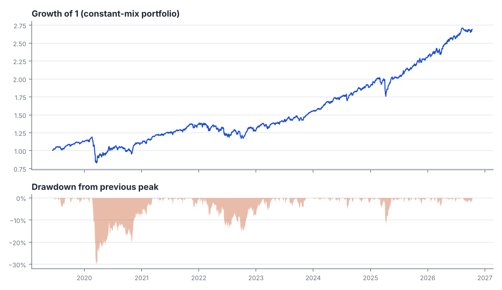
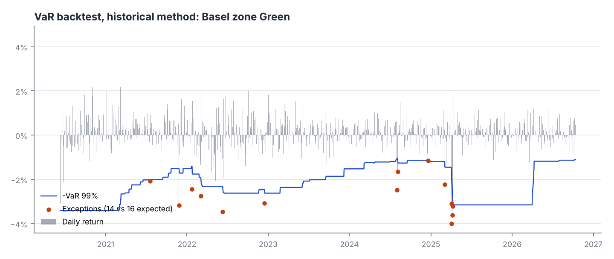
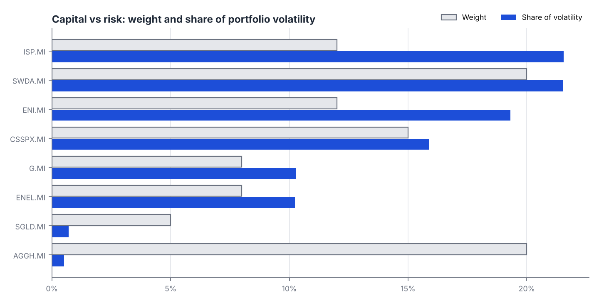
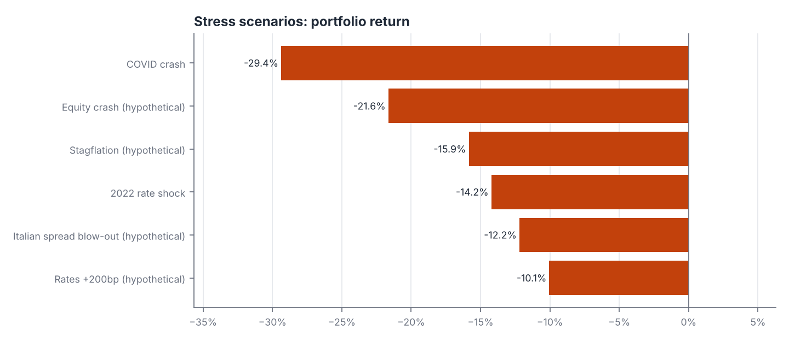

# RiskLite case study: a typical Italian retail portfolio

*Generated 2026-10-12 by RiskLite 1.0.0. Data source: Yahoo Finance (adjusted close). Sample: 2019-06-13 to 2026-10-12 (1864 trading days).*

This report is descriptive analysis of historical risk. It is not investment advice.

## Portfolio

A home-biased portfolio of the kind often seen in Italian households: large Italian blue chips (energy, banking, utilities, insurance) next to global equity ETFs, a bond ETF and gold.

| Position | Weight |
|---|---|
| AGGH.MI | 20.0% |
| SWDA.MI | 20.0% |
| CSSPX.MI | 15.0% |
| ENI.MI | 12.0% |
| ISP.MI | 12.0% |
| ENEL.MI | 8.0% |
| G.MI | 8.0% |
| SGLD.MI | 5.0% |

Note: History starts on 2019-06-12, the first date with prices for every asset.

## Key findings

- Annualised volatility is 13.1% and the worst peak-to-trough fall in the sample was -30.5% (2020-02-19 to 2020-03-18).
- 1-day 99% VaR is 2.50% (historical) against 1.91% under a normal distribution; on the days beyond VaR the average loss (ES) is 3.78%.
- The normal model understates tail risk by about 31%: returns are fat-tailed (excess kurtosis 24.1).
- ISP.MI is 12% of the portfolio but 22% of its volatility.
- 2 positions contribute at least 30% more risk than their weight: ISP.MI, ENI.MI (41% of risk from 24% of capital).
- Diversification ratio is 1.38 (1.00 would mean no diversification benefit); the portfolio behaves like 6.8 equal-weight positions.
- Backtest (historical VaR): 14 exceptions in 1614 days vs 16.1 expected; Kupiec p = 0.584, Basel zone Green. Right frequency, but exceptions cluster in time.
- Backtest (parametric VaR): 27 exceptions in 1614 days vs 16.1 expected; Kupiec p = 0.013, Basel zone Yellow. Underestimates risk: too many exceptions.
- Backtest (ewma VaR): 35 exceptions in 1614 days vs 16.1 expected; Kupiec p = 0.000, Basel zone Red. Underestimates risk: too many exceptions.
- Worst historical scenario replayed: COVID crash, -29.4% over 24 trading days.
- Not enough price history to replay: Global Financial Crisis, Euro sovereign crisis.

## Performance and drawdown

| Annual return | Annual volatility | Sharpe | Sortino | Max drawdown | Skewness | Excess kurtosis |
|---|---|---|---|---|---|---|
| 14.33% | 13.05% | 1.10 | 1.47 | -30.47% | -1.66 | 24.07 |

## Value at Risk and Expected Shortfall (1-day, 99%)

Losses as a fraction of portfolio value.

| Method                         |    VaR |       ES |
|:-------------------------------|-------:|---------:|
| Historical                     | 0.0250 |   0.0378 |
| Parametric (normal)            | 0.0191 |   0.0219 |
| Cornish-Fisher (skew/kurtosis) | 0.0669 | nan      |
| Monte Carlo (bootstrap)        | 0.0249 |   0.0386 |

## Does the VaR model work? Backtest

Rolling 250-day one-day-ahead forecasts compared with the next day's realised return. Kupiec tests the exception frequency, Christoffersen tests whether exceptions cluster.

| Method     |   Days |   Exceptions |   Expected |   Kupiec p |   Christoffersen p | Zone   | Verdict                                         |
|:-----------|-------:|-------------:|-----------:|-----------:|-------------------:|:-------|:------------------------------------------------|
| historical |   1614 |           14 |     16.100 |      0.584 |              0.000 | Green  | Right frequency, but exceptions cluster in time |
| parametric |   1614 |           27 |     16.100 |      0.013 |              0.000 | Yellow | Underestimates risk: too many exceptions        |
| ewma       |   1614 |           35 |     16.100 |      0.000 |              0.044 | Red    | Underestimates risk: too many exceptions        |

## Where the risk comes from

Euler decomposition: contributions add up exactly to portfolio volatility.

|          |   Weight |   Marginal vol |   Vol contribution |   Share of risk |   Risk / weight |   Component VaR |
|:---------|---------:|---------------:|-------------------:|----------------:|----------------:|----------------:|
| ENI.MI   |   0.1200 |         0.2101 |             0.0252 |          0.1931 |          1.6095 |          0.0037 |
| ISP.MI   |   0.1200 |         0.2343 |             0.0281 |          0.2155 |          1.7954 |          0.0041 |
| ENEL.MI  |   0.0800 |         0.1670 |             0.0134 |          0.1023 |          1.2792 |          0.0020 |
| G.MI     |   0.0800 |         0.1680 |             0.0134 |          0.1029 |          1.2868 |          0.0020 |
| SWDA.MI  |   0.2000 |         0.1404 |             0.0281 |          0.2151 |          1.0757 |          0.0041 |
| CSSPX.MI |   0.1500 |         0.1382 |             0.0207 |          0.1588 |          1.0585 |          0.0030 |
| AGGH.MI  |   0.2000 |         0.0033 |             0.0007 |          0.0051 |          0.0254 |          0.0001 |
| SGLD.MI  |   0.0500 |         0.0186 |             0.0009 |          0.0071 |          0.1425 |          0.0001 |

## Stress tests

Historical replay of the current weights:

| Scenario                | Window                   |   Return |   Max drawdown | Covered   |
|:------------------------|:-------------------------|---------:|---------------:|:----------|
| Global Financial Crisis | 2008-09-12 to 2009-03-09 | nan      |       nan      | no data   |
| Euro sovereign crisis   | 2011-07-01 to 2011-11-25 | nan      |       nan      | no data   |
| COVID crash             | 2020-02-19 to 2020-03-23 |  -0.2937 |        -0.3047 | yes       |
| 2022 rate shock         | 2022-01-03 to 2022-10-12 |  -0.1423 |        -0.1546 | yes       |

Hypothetical instantaneous shocks by asset class (illustrative assumptions, editable in the app):

|                         |   Portfolio impact |   Commodity |   Equity |   Government bond |
|:------------------------|-------------------:|------------:|---------:|------------------:|
| Equity crash            |            -0.2165 |      0.0025 |  -0.2250 |            0.0060 |
| Rates +200bp            |            -0.1005 |     -0.0015 |  -0.0750 |           -0.0240 |
| Stagflation             |            -0.1585 |      0.0075 |  -0.1500 |           -0.0160 |
| Italian spread blow-out |            -0.1220 |      0.0025 |  -0.1125 |           -0.0120 |

Worst rolling periods in the sample:

|   Length (days) | Start      | End        |   Return |
|----------------:|:-----------|:-----------|---------:|
|               1 | 2020-03-12 | 2020-03-12 |  -0.1037 |
|               1 | 2020-03-09 | 2020-03-09 |  -0.0786 |
|               1 | 2025-04-04 | 2025-04-04 |  -0.0400 |
|               5 | 2020-03-06 | 2020-03-12 |  -0.2057 |
|               5 | 2025-04-03 | 2025-04-09 |  -0.1169 |
|               5 | 2020-02-24 | 2020-02-28 |  -0.0976 |
|              21 | 2020-02-19 | 2020-03-18 |  -0.3009 |
|              21 | 2022-06-07 | 2022-07-05 |  -0.0977 |
|              21 | 2025-03-12 | 2025-04-09 |  -0.0859 |

## Limitations

- History is a sample, not a forecast. Risk measured over calm years understates crisis risk.
- Constant-mix weights: the portfolio is assumed to be rebalanced daily to target weights.
- Multi-day VaR uses square-root-of-time scaling, which ignores volatility clustering.
- Hypothetical shocks are round-number assumptions for discussion, not calibrated forecasts.
- Prices are adjusted closes from the stated source; data errors propagate into every figure.

See docs/METHODOLOGY.md for formulas and references.